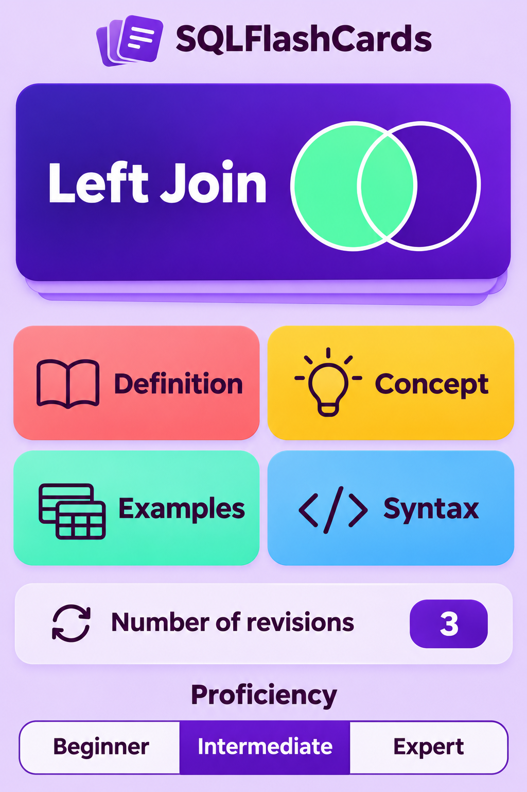

# Architecture

SQLFlashCards uses a staged implementation. This document records the agreed architecture and distinguishes the first working learning flow from future progress and delivery features.

## Current implementation scope

The Stage 1 foundation provides React, strict TypeScript, Vite, ESLint, Vitest, a dependency lockfile, and CI checks. The first learning flow now loads validated versioned JSON with all 14 syllabus topics and six starter cards across Basic queries, Filtering, and Joins. Learners can choose a topic, reveal answers, toggle four learning sections, and navigate between cards. Empty topics display Content coming soon. This stage does not track completion, schedule reminders, or store learner data.

The application is developed and checked locally. Hosting setup, service purchases, Android packaging, and public releases are outside this stage.

## Decisions

| Area | Decision | Current status |
| --- | --- | --- |
| Interface | React and TypeScript with strict type checking | Topic and learning screens implemented |
| Development and build | Vite | Configured |
| Source of truth | GitHub for code, content, tests, and documentation | Repository and PR workflow |
| Learning content | General SQL topics in versioned JSON in Git; label database-specific syntax and behaviour in relevant examples | Runtime-validated catalogue with six starter cards and curriculum mappings |
| Learner progress | IndexedDB in the browser | Planned |
| Web hosting | Vercel | Planned; no deployment |
| Android distribution | Trusted Web Activity through Bubblewrap | Planned; no Android package |
| Accounts and synchronization | A later cloud phase | Deferred |
| SQL execution | Display examples; do not execute user-supplied SQL in the MVP | Examples and result tables displayed; no execution environment |

## Visual design reference

The user supplied this mockup on November 19, 2026 as the intended visual direction for both the Android app and the web browser experience.

- Use a light lavender background, purple gradients, large rounded cards, soft shadows, bold dark text, and the SQLFlashCards name with a stacked-card logo.
- Place a prominent purple topic card below the header, with the topic name and an explanatory visual. The example shows Left Join with the entire left circle shaded green, including the overlap.
- Arrange four large learning tiles in two columns: Definition in coral, Concept in yellow, Examples in mint green, and Syntax in blue. Pair each label with a simple icon.
- Show a separate Number of revisions row with a revision icon and a prominent purple count badge.
- Show Proficiency below it, with Beginner, Intermediate, and Expert levels and a purple highlight for the current level.
- Preserve this visual hierarchy across Android and web, adapting sizing and spacing to the screen while keeping text readable and controls easy to tap.

Left Join is implemented as a starter card, while the count of 3 and the highlighted Intermediate level remain illustrative mockup values. The current screen uses the reference's colour palette, hero, section tiles, and join diagram, adding question/reveal and bounded previous/next navigation. Tiles toggle one inline panel; Close returns focus to the originating tile. Revision and proficiency widgets remain hidden until the relevant persistence and scoring policies are implemented. The original reference image is preserved.

## Module boundaries

`src/main.tsx` mounts React. `src/app/` contains the screen host, hash-route handling, topic and learning screens, content rendering, styling, and interaction tests. `src/content/` owns the JSON catalogue, content types, loader, runtime validation, and content tests. Shared styling lives in `src/styles.css`; test setup lives in `src/test/`. Keep configuration at the repository root and project design, status, reference, and educational artifacts in `docs/project-artifacts/`.

As later stages introduce behavior, use these boundaries:

| Boundary | Responsibility | Constraints |
| --- | --- | --- |
| UI: `src/app/` | Render learning state and handle user actions | Delegate scheduling and scoring to the domain layer. |
| Domain: future `src/domain/` | Pure rules for progress, revision scheduling, counts, and expertise | No React, browser storage, network calls, or implicit system clock. Pass dates and other inputs explicitly. |
| Storage: future `src/storage/` | IndexedDB access, persistence, and data migrations | Implement interfaces consumed by application services; keep database details out of components and domain rules. |
| Content: `src/content/` | Versioned JSON questions, answers, explanations, tables, SQL examples, and syllabus IDs | Validate before rendering; reject invalid catalogues rather than silently dropping cards. Keep content separate from future learner records and identify database-specific examples. |

The future domain and storage directories are intentionally not created for the content/reveal flow. Their interfaces should follow the requirements of the stage that introduces them. Hash routes validate both card and topic identity; direct links, refresh, and browser history load the requested content without retaining transient answers or open sections.

## Learning requirements for later stages

- Separate covered and uncovered syllabus views, with completion independent of mastery.
- Performance feedback and durable review history extending the implemented answer-reveal flow.
- Saved local progress in IndexedDB, including topic completion and revision history.
- A visible count of how many times each topic has been revised.
- An expertise level for each topic derived from performance, with an explanation the learner can understand.
- Revision reminders following the requested 1, 3, 5, 7, 20, and 30 day rule.

These are requirements, not implemented functionality. The reminder stage must decide whether those day numbers are offsets from initial learning or intervals between revisions, what happens after a missed reminder, which timezone applies, and how a revision is counted. The expertise stage must define the performance inputs, thresholds, and behavior when there is too little evidence to assign a level.

Closed-app alarms, notification permissions, and delivery guarantees also need an explicit design and verification stage. The scaffold makes no promise that a reminder can fire while the browser or Android app is closed.

## Quality and delivery

Keep TypeScript strict for both application code and tooling. Use automated linting, content validation tests, interaction tests, and a production build. Keep future business rules testable independently of the UI and IndexedDB. Actual check outcomes are recorded in [Project status](status.md), and repeatable browser test steps are in the [repository README](../../readme.md#manual-verification).

Use `npm ci` for reproducible installs from the committed lockfile. Run `npm run check` locally and inspect the GitHub Actions result on the PR. Record failures or unavailable checks honestly; do not replace a failed test with a weaker one or disable checks to obtain a pass.

Use small branches and reviewable PRs. Each stage report must include changed files, check evidence, manual verification instructions, outstanding issues, and a branch/commit or PR link. Update documentation when behavior changes.

Keep secrets, signing keys, and learner records out of Git. No cloud credentials are required for the current learning flow. Provisioning Vercel, configuring Bubblewrap, setting up cloud accounts, or publishing a release requires a separately requested stage.
