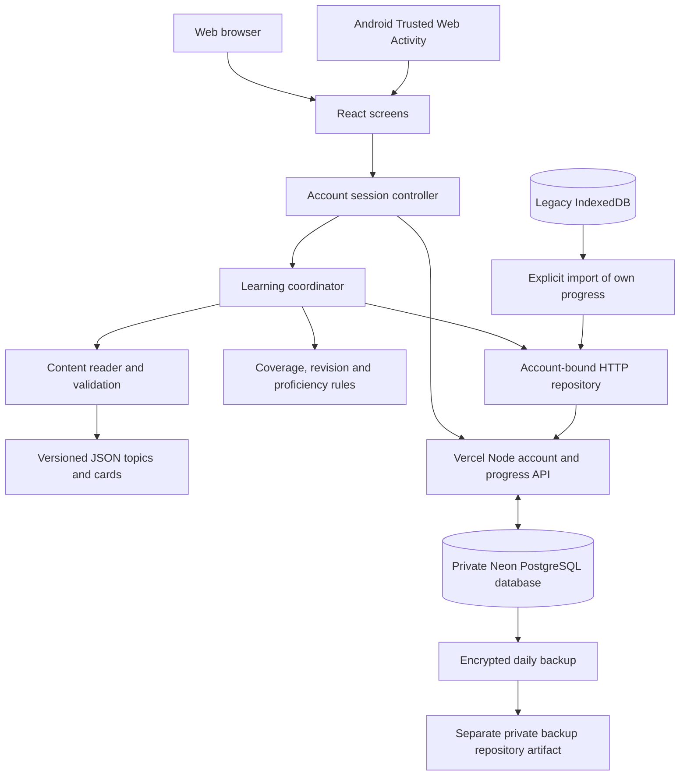
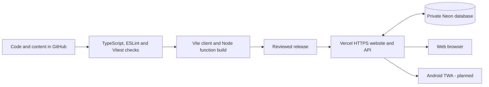

# SQLFlashCards High Level Design

SQLFlashCards uses a shared React and TypeScript learning interface and a Node.js account service. It teaches SQL through flashcards and tracks each account's syllabus completion in a server database. The Android delivery plan reuses the web interface; an Android package is not yet built.

This design follows the [architecture decisions](architecture.md), [14-topic syllabus](syllabus.md), and [user's visual mockup](app-design-reference.png). The learning flow includes all 14 topic headings, six starter cards across Basic queries, Filtering, and Joins, answer reveal, inline learning sections, and card navigation. The other 11 topics show Content coming soon. The account stage adds simple name-and-four-digit-PIN sign-up/sign-in and server-owned Completed/Incomplete records, retaining the existing filters and summary. The hosting path uses Vercel and Neon; its deployment and backup evidence are tracked in [Project status](status.md). Review rules and Android packaging remain planned. See [Account and progress design](account-progress.md) for the account/API boundary and operational requirements.

See the [Low level design](lld.md) for implemented component and storage contracts, proposed review flows, screen interactions, and verification requirements.

The separate [SQL syllabus index](sql-syllabus-index.md) expands the same 14 learning modules into numbered subtopics with outcomes and source references. Starter cards map explicitly to that index; their availability does not mean a learner has completed those topics or that the full curriculum has been authored.

## Product scope

The learning experience will provide topic selection, questions and answer reveal, Definition, Concept, Examples, and Syntax sections, performance feedback, covered/uncovered topics, revision counts, and proficiency levels. Revision scheduling must support the requested 1, 3, 5, 7, 20, and 30 day rule once its timing semantics are defined.

The app displays SQL examples without executing learner queries. Each learner signs in with a unique name and four-digit PIN; no email field is required. Progress belongs to the account and is read from the same website's server when signing in from another browser. Clearing browser data removes the session, not the server's progress records. The learning scope remains general SQL; PostgreSQL in production and SQLite locally are application storage choices, not teaching dialects.

## System structure

The diagram distinguishes client presentation from server-owned account data. Browser profiles share an account's progress only when they sign in to the same service/database. The user selected free hosting plans and new online accounts; local test records remain on the development computer. The diagram shows the production design, not evidence that its services are provisioned.

| Component | Responsibility | Current state |
| --- | --- | --- |
| React screens | Show topics, learning cards, completion, and later due revisions. | Topic list, question/reveal, four inline sections, bounded card navigation, explicit completion controls, filters, and progress summary implemented. |
| Learning coordinator | Load content and progress, validate actions, save results, and refresh the screen. | Content/routes and topic-progress loading, saving, retry, and focus/visibility refresh implemented; review workflows remain planned. |
| Content reader | Load and validate reviewed topics and cards from versioned JSON. | Bundled JSON with runtime validation, 14 topic records, and six starter cards. |
| Domain rules | Calculate coverage, revision counts, due dates, and proficiency. | Explicit topic completion and active-syllabus coverage implemented; review counting, scheduling, and scoring remain open. |
| Account controller | Sign up, sign in, sign out, check sessions, and separate displayed account state. | Name/PIN form and session boundary; no PIN or session token in browser storage. |
| HTTP repository | Read and write progress through the current session, with an expected-account guard. | Account-scoped requests and version-conflict handling replace browser storage as the authoritative path. |
| Node API | Authenticate sessions, validate requests, enforce account ownership, and commit records. | Same-origin session and progress endpoints, PIN hashing, attempt limits, and server timestamps. |
| Account database | Keep accounts, sessions, attempt limits, and account/topic progress privately. | Neon PostgreSQL for Vercel; a persistent SQLite file for local development. Both enforce account ownership and transactional saves. |
| Legacy IndexedDB | Preserve prior browser-only progress for optional import. | `sqlflashcards`, version 1, `topicProgress`; never automatically assigned to an account or deleted by import. |
| Website hosting | Serve the UI and API over HTTPS with external durable storage. | Vercel deployment configuration plus private Neon database; live status is recorded separately. |
| Backups | Recover records after accidental loss or corruption. | Neon restore history plus daily encrypted exports retained 30 days in a separate private GitHub repository's Actions artifacts; reviewed workflow code is SHA-pinned, and activation and restore tests are release requirements. |
| Android package | Open the hosted web experience through a Trusted Web Activity, built using Bubblewrap. | Planned; no Android package. |

The UI calls a progress coordinator and repository interface rather than opening server transactions. The server derives ownership from the authenticated session, validates topic identity and content availability, and supplies authoritative change times. Client account IDs are stale-request guards, never authorization. Future review calculations follow this account boundary.

The browser keeps an HttpOnly session cookie; the database keeps account progress independently of a Vercel deployment or function instance. Sign-out or session expiry clears displayed account state. A failed request is visible and is not replaced with an anonymous browser save. Existing browser-only records can be copied only through an explicit import action, without overwriting account records. The [deployment runbook](deployment.md) defines backup activation, retention limits, and restoration; retaining a browser cookie is neither storage durability nor backup.

## Screens and visual direction

The account screen uses the same lavender and purple visual direction, with labelled Name and four-digit PIN fields and separate sign-up/sign-in actions. After authentication, hash navigation connects the topic list and topic/card learning screen, including direct links and browser Back/Forward. The learning screen follows the supplied mockup's large purple concept card, join visuals, and four coloured tiles. The due-revision view, revision-count row, and proficiency indicators remain future work.

Definition uses coral, Concept yellow, Examples mint, and Syntax blue. The tile layout adapts to available width and uses keyboard-accessible disclosure buttons. Each opens one inline section below the grid; selecting it again closes the section, and its Close button returns focus to the tile.

The mockup's Left Join is now a starter card. Its revision count of 3 and Intermediate highlight remain illustrative values, never initial learner data. Explicit topic completion appears on the topic list and learning screen, separate from the future proficiency assessment. All, Completed, and Incomplete filters show the relevant topics without changing their saved status.

## Data ownership

Topic, Flashcard, and Topic progress are implemented. Revision records and derived revision state remain proposed:

| Record | Main information | Source of truth |
| --- | --- | --- |
| Topic | Stable ID, title, syllabus order, and related cards. | Versioned JSON in Git. |
| Flashcard | Stable ID, topic ID, question, answer, definition, concept, examples, syntax, and optional visual. | Versioned JSON in Git. |
| Account | Stable account ID, unique normalized name, display name, and PIN verifier. | Server database; never the browser's claimed identity. |
| Session | Hashed opaque session token, account ID, and expiry. | Server database; raw token only in an HttpOnly cookie. |
| Topic progress | Account ID, topic ID, covered/uncovered state, completion date, last-change time, and concurrency version. | Server database, keyed by account and topic. |
| Revision record | Unique record ID, account/topic/card reference, timestamp, and learner feedback. | Proposed server-owned history; not implemented. |
| Revision state | Schedule position and next due date calculated from revision history and agreed rules. | Proposed account-scoped projection; not implemented. |

Revision counts and proficiency should come from learner activity and the agreed rules. Opening a page or refreshing the browser must not itself add a revision. Stable content IDs will keep progress attached to the right learning material when content changes; storage migrations will preserve existing records when the app's data format changes.

Topic completion is a separate learner action. A covered topic may still need revision. Syllabus progress is `covered active topics / total active topics * 100`, with 0% for an empty catalogue; it is not the same as proficiency. All 14 active topics count, including those awaiting cards. Missing saved records mean incomplete, and an empty topic cannot be newly completed. Existing completion survives removal of its cards and can be reopened; retired-topic records are preserved but excluded from the percentage.

## Learning interaction

The implemented flow loads and validates bundled content, opens a topic's first available card, reveals an answer on request, toggles reference sections, and moves between cards. Unknown routes or mismatched topic/card IDs show an unavailable-content view. Card changes, browser history navigation, and reloads reset answer visibility and the open section. These actions create no learner records.

The completion flow loads the signed-in account's topic records, validates an explicit action on the client and server, and writes it with the version last read. The UI changes to the saved value only after the server commits. A newer change from another tab or browser produces a visible conflict and explicit retry. Focus/visibility refresh checks session and saved state; late results from another account must not appear in the current account. Loading, reading, and navigating do not write completion records.

The following review extension remains planned:

1. The app loads the content collection and reads the authenticated account's learner records.
2. The learner selects a topic and reads a question or learning section.
3. The learner reveals the answer and submits performance feedback.
4. The coordinator passes that action, previous records, and the current time to the domain rules.
5. The rules calculate the resulting revision state and proficiency under the agreed policy.
6. The storage adapter saves the completed activity and its resulting state together, then the UI shows the updated values. A failed save offers a retry without double-counting the activity.
7. When the learner returns, the app reloads saved progress and identifies revisions that are due.

The precise action that qualifies as a completed revision must be settled before implementing steps 4 through 6. Marking a topic covered or uncovered updates completion independently.

## Build and delivery

Node.js runs the API and development tools. The development command starts the local SQLite API and Vite. Vercel builds the browser assets and a same-origin Node function, while Neon stores account data outside Vercel's temporary filesystem. GitHub Actions installs locked dependencies and checks pull requests and main; publication and production release remain distinct actions. Configure Vercel against the reviewed GitHub source, using private production settings for the database connection and stable PIN pepper. The [deployment runbook](deployment.md) covers HTTPS, free-plan limits, backups, restoration, and the release checklist. No paid upgrade is authorized.

For Android, Bubblewrap will create the package that opens the hosted app through a Trusted Web Activity. Website ownership must be verified using Digital Asset Links. This is a wrapper around the web experience, so the learning UI and rules remain in the shared web code. See the [Chrome Trusted Web Activity guide](https://developer.chrome.com/docs/android/trusted-web-activity/quick-start).

## Reminders and future capabilities

The proposed first reminder capability is an in-app due list calculated from saved revision dates when the app opens. Notification delivery is a separate component to design after deciding whether reminders must work while the app is closed and how precise their timing must be.

Browsers control service-worker execution and background scheduling. Adding the account API does not implement a reminder scheduler or promise exact closed-app alarms; see [MDN's background-operation guidance](https://developer.mozilla.org/en-US/docs/Web/Progressive_web_apps/Guides/Offline_and_background_operation).

Offline launching requires a separate asset-caching and write-queue design. Account progress is shared through the running service; requests require a connection. The backup workflow protects stored records but does not provide forgotten-PIN recovery. A four-digit PIN has only 10,000 possible values: hashing and attempt limits reduce exposure but do not make it a strong credential. No email-based recovery is available in this two-field design.

## Validation and remaining decisions

The `npm.cmd run check` command checks client/server types, linting, tests, and production builds. The account stage adds HTTP/database tests for ownership, session lifecycle, guessing limits, validation, concurrent writes, and persistence across server restart. Actual results belong in [Project status](status.md). Real-browser checks must verify separate accounts, sign-in from another profile, refresh/reopen, import, request failures, session expiry, responsive layouts, keyboard access, and the supplied visual direction. Simulated UI/IndexedDB tests do not replace those checks. Later reviews need duplicate-submission, date, and scoring tests; Android delivery needs device and domain-verification checks.

Before implementing the corresponding features, settle these decisions:

- How the displayed revision count relates to individual cards, concepts, or whole topics; the initial topic/card mapping is now explicit in the content catalogue.
- Whether 1, 3, 5, 7, 20, and 30 days are offsets from first learning or gaps between revisions; also timezone and missed-revision behaviour.
- What action counts as a revision, what feedback is collected, how proficiency is calculated, and what to display before there is enough evidence.
- How content IDs and saved-data versions evolve as the authored catalogue and learner records grow.
- Whether reminders require closed-app delivery, and whether offline launch or progress export is needed for the first release.

The immediate delivery step is to complete the Vercel/Neon provisioning, verify HTTPS and two-account persistence in a real browser, and prove backup restoration before declaring the website ready. Then expand the reviewed card collection and settle what counts as a revision before adding durable review history and counts. Scheduling/proficiency rules and Android packaging remain separate delivery steps.
