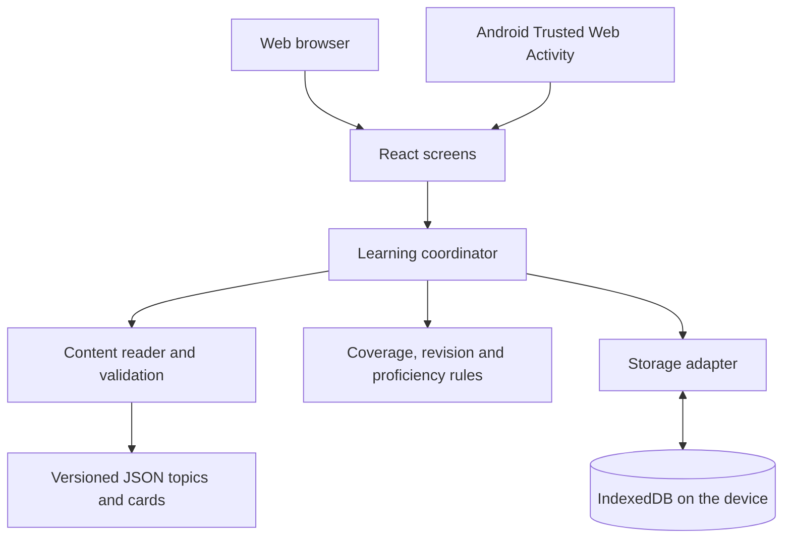
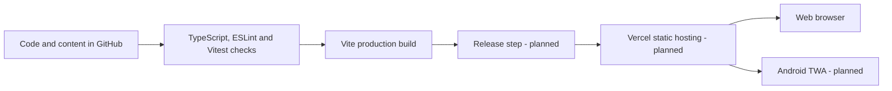

# SQLFlashCards High Level Design

SQLFlashCards will use one React and TypeScript web application for desktop browsers and Android. It will teach SQL through flashcards, track syllabus coverage, and help learners revise. Learning content will ship with the app; learner progress will be stored locally on the device.

This design follows the [architecture decisions](architecture.md), [14-topic syllabus](syllabus.md), and [user's visual mockup](app-design-reference.png). The first working learning flow now includes all 14 topic headings, six starter cards across Basic queries, Filtering, and Joins, answer reveal, inline learning sections, and card navigation. The other 11 topics show Content coming soon. Progress rules, storage, hosting, and the Android package remain planned.

See the [Low level design](lld.md) for proposed components, TypeScript contracts, storage transactions, screen interactions, and implementation checks.

The separate [SQL syllabus index](sql-syllabus-index.md) expands the same 14 learning modules into numbered subtopics with outcomes and source references. Starter cards map explicitly to that index; their availability does not mean a learner has completed those topics or that the full curriculum has been authored.

## Product scope

The learning experience will provide topic selection, questions and answer reveal, Definition, Concept, Examples, and Syntax sections, performance feedback, covered/uncovered topics, revision counts, and proficiency levels. Revision scheduling must support the requested 1, 3, 5, 7, 20, and 30 day rule once its timing semantics are defined.

The first release will display SQL examples without executing queries. It will use local progress without accounts or cloud synchronization. The learning scope is general SQL; examples identify the relevant database when syntax or behaviour is engine-specific. The app does not require a database server.

## System structure

The diagram shows the target components inside each running client. The two entry points use the same web implementation; they do not imply a shared progress database across devices or browser profiles.

| Component | Responsibility | Current state |
| --- | --- | --- |
| React screens | Show topics and learning cards; later add due revisions and progress. | Topic list, question/reveal, four inline sections, and bounded card navigation implemented. |
| Learning coordinator | Load content and progress, pass actions to the rules, save results, and refresh the screen. | Current App coordinates content and routes with transient React state; persistence services remain planned. |
| Content reader | Load and validate reviewed topics and cards from versioned JSON. | Bundled JSON with runtime validation, 14 topic records, and six starter cards. |
| Domain rules | Calculate coverage, revision counts, due dates, and proficiency. | Planned; counting, scheduling, and scoring details remain open. |
| Storage adapter | Read and write learner records and handle changes to the stored-data format. | Planned. |
| IndexedDB | Keep structured learner records in the browser. | Planned. |
| Vercel | Serve the built application and learning content over HTTPS. | Planned; no deployment. |
| Android package | Open the hosted web experience through a Trusted Web Activity, built using Bubblewrap. | Planned; no Android package. |

The UI will call the coordinator rather than accessing IndexedDB directly. Domain rules will be independent of React, browser storage, and network access; the coordinator will supply the current time explicitly so scheduling can be tested predictably.

IndexedDB is scoped to the website's origin. Local records are not a cloud backup, and clearing site data can remove progress. Storage failures must be visible to the learner rather than reported as successful saves. See [MDN's IndexedDB overview](https://developer.mozilla.org/en-US/docs/Web/API/IndexedDB_API/Basic_Terminology).

## Screens and visual direction

Implemented hash navigation connects the topic list and topic/card learning screen, including direct links and browser Back/Forward. The learning screen follows the supplied mockup's lavender background, large purple concept card, join visuals, and four coloured learning tiles. The due-revision view, revision-count row, and proficiency indicators remain future work and are hidden until their policies and persistence exist.

Definition uses coral, Concept yellow, Examples mint, and Syntax blue. The tile layout adapts to available width and uses keyboard-accessible disclosure buttons. Each opens one inline section below the grid; selecting it again closes the section, and its Close button returns focus to the tile.

The mockup's Left Join is now a starter card. Its revision count of 3 and Intermediate highlight remain illustrative values, never initial learner data. Topic completion is not yet recorded, and proficiency still depends on future scoring rules and performance evidence.

## Data ownership

The following are proposed logical records, not a final storage schema:

| Record | Main information | Source of truth |
| --- | --- | --- |
| Topic | Stable ID, title, syllabus order, and related cards. | Versioned JSON in Git. |
| Flashcard | Stable ID, topic ID, question, answer, definition, concept, examples, syntax, and optional visual. | Versioned JSON in Git. |
| Topic progress | Topic ID, covered/uncovered state, and completion date if applicable. | IndexedDB. |
| Revision record | Unique record ID, topic/card reference, timestamp, and learner feedback. | IndexedDB. |
| Revision state | Schedule position and next due date calculated from revision history and the agreed rules. | IndexedDB, derived from learner activity. |

Revision counts and proficiency should come from learner activity and the agreed rules. Opening a page or refreshing the browser must not itself add a revision. Stable content IDs will keep progress attached to the right learning material when content changes; storage migrations will preserve existing records when the app's data format changes.

Topic completion is a separate learner action. A covered topic may still need revision. Syllabus progress is `covered topics / total topics * 100`; it is not the same as proficiency.

## Learning interaction

The implemented flow loads and validates bundled content, opens a topic's first available card, reveals an answer on request, toggles reference sections, and moves between cards. Unknown routes or mismatched topic/card IDs show an unavailable-content view. Card changes, browser history navigation, and reloads reset answer visibility and the open section. These actions create no learner records.

The following extension remains planned:

1. The app loads the content collection and reads local learner records.
2. The learner selects a topic and reads a question or learning section.
3. The learner reveals the answer and submits performance feedback.
4. The coordinator passes that action, previous records, and the current time to the domain rules.
5. The rules calculate the resulting revision state and proficiency under the agreed policy.
6. The storage adapter saves the completed activity and its resulting state together, then the UI shows the updated values. A failed save offers a retry without double-counting the activity.
7. When the learner returns, the app reloads saved progress and identifies revisions that are due.

The precise action that qualifies as a completed revision must be settled before implementing steps 4 through 6. Marking a topic covered or uncovered updates completion independently.

## Build and delivery

Node.js and npm run the development tools. Vite serves the app locally during development and produces the release files. GitHub Actions is configured to install locked dependencies and run checks on pull requests and pushes to main; it does not currently deploy the app.

For Android, Bubblewrap will create the package that opens the hosted app through a Trusted Web Activity. Website ownership must be verified using Digital Asset Links. This is a wrapper around the web experience, so the learning UI and rules remain in the shared web code. See the [Chrome Trusted Web Activity guide](https://developer.chrome.com/docs/android/trusted-web-activity/quick-start).

## Reminders and future capabilities

The proposed first reminder capability is an in-app due list calculated from saved revision dates when the app opens. Notification delivery is a separate component to design after deciding whether reminders must work while the app is closed and how precise their timing must be.

Browsers control service-worker execution and background scheduling. Consequently, this client-only design does not promise exact closed-app alarms; that is a design constraint inferred from [MDN's background-operation guidance](https://developer.mozilla.org/en-US/docs/Web/Progressive_web_apps/Guides/Offline_and_background_operation).

Offline launching requires a separate asset-caching design; local progress storage alone does not provide it. Accounts, cloud backup, and synchronization across devices are later capabilities and would require additional services and data-conflict rules.

## Validation and remaining decisions

The existing `npm.cmd run check` command runs type checking, linting, tests, and the production build. The first flow adds content and interaction tests; actual executed results belong in [Project status](status.md). Later checks must cover saved-progress reload, failed saves and duplicate submissions, revision dates, scoring, and content/storage upgrades. Browser checks cover narrow and desktop layouts, keyboard access, and the supplied visual direction. Android delivery will need device testing and domain-verification checks.

Before implementing the corresponding features, settle these decisions:

- How the displayed revision count relates to individual cards, concepts, or whole topics; the initial topic/card mapping is now explicit in the content catalogue.
- Whether 1, 3, 5, 7, 20, and 30 days are offsets from first learning or gaps between revisions; also timezone and missed-revision behaviour.
- What action counts as a revision, what feedback is collected, how proficiency is calculated, and what to display before there is enough evidence.
- How content IDs and saved-data versions evolve as the authored catalogue and learner records grow.
- Whether reminders require closed-app delivery, and whether offline launch or progress export is needed for the first release.

The next implementation step is explicit topic completion and IndexedDB persistence with save/reload and failure handling. Expand the reviewed card collection alongside later stages. Revision rules, hosting, and Android packaging remain separate delivery steps.
