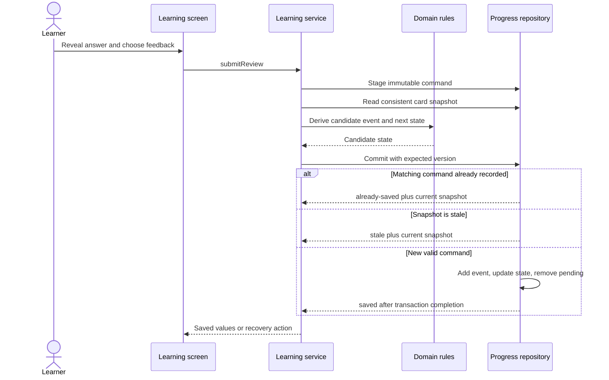

# SQLFlashCards Low Level Design

This design translates the [HLD](hld.md) and [visual mockup](app-design-reference.png) into React components, content contracts, account-owned completion, and future review flows. The working flow includes validated content, a 14-topic list, six starter cards, hash navigation, question/reveal, four inline sections, and explicit saved topic completion. The account extension uses simple name-and-four-digit-PIN authentication and server persistence. Feedback, review history, revision counts, scheduling, and proficiency contracts remain proposed. The [Account and progress design](account-progress.md) is the detailed account/API reference.

The application consists of a React/TypeScript client, versioned JSON learning content, and a Node.js account/progress API backed by persistent SQLite. IndexedDB is retained only as an explicit import source for earlier browser progress. Production hosting and an Android Trusted Web Activity package remain planned. Content teaches general SQL; backend SQLite is an implementation choice, not the teaching dialect. SQL examples are displayed, not executed. Offline launch, queued offline changes, and background notifications remain outside this stage.

## Design choices and unresolved policies

The content hierarchy, tile interaction, hash navigation, explicit topic completion, and account persistence are implemented in this stage. Feedback and review activity records remain proposed; actual verification belongs in status:

| Area | Choice and delivery status |
| --- | --- |
| Content hierarchy | A topic is one of the 14 syllabus groups. A flashcard tests one question/concept within a topic. `joins` contains card `joins-left-basic`, displayed as Left Join. |
| Tile interaction | Definition, Concept, Examples, and Syntax buttons toggle one inline section panel below the tile grid. |
| Navigation | Hash routes with validated topic/card IDs and browser Back/Forward support. No router package is currently installed. |
| Screen state | An account/session boundary owns the learning instance. Progress is shared across topic/card screens for that account and discarded from the visible session on sign-out or identity change. |
| Topic completion | Explicit Completed/Incomplete actions, All/Completed/Incomplete filters, and an active-topic progress summary. Reading cards never automatically completes a topic. |
| Feedback | After revealing an answer, the learner chooses Need practice, With help, or Confident. These are self-reports, not automatic SQL grading. |
| Activity records | Persist individual completed card-review events with stable IDs. The displayed card's counter is derived from those events under the eventual revision-counting policy. |
| Storage | The HTTP repository reaches authenticated server records. Legacy IndexedDB is available for explicit import only. Durable pending review submissions remain a later-stage design. |
| Sign-up | Name and four-digit PIN only. Name is unique after normalization; PIN is a string to preserve leading zeroes. No email or automatic account-recovery flow. |

These choices make the design concrete without settling the HLD's open learning policies. In particular, a sum of card reviews is not automatically a completed whole-topic revision. The product decisions near the end of this document must be resolved before enabling their dependent features.

## Screens and mockup mapping

| Route | Screen | Behaviour |
| --- | --- | --- |
| `#/topics` | Topic list | Implemented: all 14 topic headings, links to available cards, progress summary, completion controls, and All/Completed/Incomplete filters. Topics without cards show Content coming soon and cannot be newly completed. |
| `#/topics/:topicId/cards/:cardId` | Learning screen | Implemented: concept hero, question/reveal, four inline sections, bounded previous/next controls, and the topic's explicit completion control. Review, revision count, and proficiency widgets are hidden until their later stages. |
| `#/revisions` | Due revisions | Planned: once scheduling is enabled, list active cards with saved due dates at or before the supplied current time. Currently treated as unavailable. |
| Unknown route or ID | Missing content view | Explain that the item is unavailable and provide a return to Topics. Never substitute an unrelated card silently. |

An unauthenticated visitor sees the account screen; an empty learning URL opens Topics after sign-in. Validate that a card belongs to the route's topic. Route changes, browser Back/Forward, and reload reset answer visibility and the open section without writing progress. In the later review stage, route changes also reset unsubmitted feedback while staged submissions remain recoverable. A late request from a previous account must never populate the current account's screen.

The tree and component contracts below describe the target decomposition, not a requirement for one file per box. The current `LearningScreen` directly owns the hero, prompt, disclosure controls, and card navigation; `LearningContent` renders section blocks and diagrams. Completion controls and saved-state feedback are implemented; feedback, revisions, and proficiency components remain future work.

```text
App
  AccountApp
    AccountForm or session-loading/error state
    AccountWorkspace (keyed by account ID)
      LearningApp
        AppHeader with account controls
        LegacyImport
        RouteView
          TopicListScreen
            CoverageSummary
            TopicFilters
            TopicList
          LearningScreen
            TopicHero
            StudyPrompt
            LearningTiles
            LearningSectionPanel
            TopicCompletion
            ReviewFeedback (future)
            RevisionSummary (future)
            ProficiencyIndicator (future)
            CardNavigation
          DueRevisionsScreen (future)
        StatusMessage
```

| Component | Inputs | User action or responsibility |
| --- | --- | --- |
| `TopicHero` | Card title and optional diagram | Display the purple hero and meaningful diagram alternative text. |
| `StudyPrompt` | Question, answer, `answerRevealed` | Emit `onReveal`; render the answer only after reveal. |
| `LearningTiles` | Active section ID | Emit `onToggle(section)`; opening the same section again closes it. |
| `LearningSectionPanel` | Section title and structured content blocks | Render text, SQL, and example tables without injecting HTML; show a SQL block's dialect label when supplied. |
| `ReviewFeedback` | Answer visibility, submission status | Emit one feedback value; disable repeated submission while saving or after success. |
| `RevisionSummary` | Derived count and its scope | Show the current card's count with a clear accessible label. No hard-coded 3. |
| `ProficiencyIndicator` | Assessed level and explanation, or insufficient evidence | Display a read-only result when assessment is enabled. No selectable difficulty tabs and no default Intermediate. |
| `CardNavigation` | Position, card count, adjacent IDs | Show Card N of M; disable Previous/Next at boundaries rather than wrap silently. |
| `CoverageSummary` | Active topics and explicit coverage records | Display coverage independently of proficiency and revision counts. |
| `TopicCompletion` | Topic identity, content availability, saved progress, and save status | Request explicit completion or reopening; disable new completion for topics without cards and while progress cannot safely be changed. |
| `StatusMessage` | Loading/save/recovery state | Explain actionable failures and announce save outcomes without stealing focus. |

The current header, hero, and four coloured tiles follow the mockup's hierarchy, with question/reveal and card navigation added for practice. The revision row, proficiency indicator, and feedback controls remain planned. Reference tiles may contain clues; opening them does not count as a review. The later review stage must record whether references were used so its scoring policy can account for assisted practice.

## Layout and accessibility

Use lavender for the page, a deep purple gradient for the hero and selected proficiency, coral for Definition, yellow for Concept, mint for Examples, and blue for Syntax. Match final colours against the saved mockup and verify readable contrast during implementation; exact colour values and typography are not inferred measurements from the image.

Proposed CSS behaviour:

- Centre the learning surface at a maximum width of approximately 960 px, with fluid spacing. Use two tile columns from 480 px upward and one below that breakpoint when labels would otherwise be crowded.
- Keep the hero title and diagram side by side when they fit and stack them on narrow screens. Test at 320, 390, 768, and 1280 px, and with enlarged text; adjust breakpoints based on actual content fit.
- Use native buttons with a minimum 44 px target, visible focus, and text labels. Tile buttons use `aria-expanded` and `aria-controls`; they are disclosure controls, not tabs.
- Keep the inline panel after the tile grid in reading order. A keyboard-accessible Close button restores focus to its tile. Route navigation focuses the new screen heading; routine save updates do not move focus.
- Display proficiency as labelled text with a highlighted segment. Before sufficient evidence, show Not assessed yet with no selected segment.
- Render SQL as selectable `<pre><code>` text. Confine horizontal scrolling to code and table panels. Diagrams need an explanation of what shading means; decorative icons are hidden from assistive technology.
- Announce saved/error states through an appropriate live region. Keep retry controls available and respect reduced-motion preferences.

## Module layout

The client flow uses `src/app/App.tsx`, account/session components, routes, topic and learning screens, and `LearningContent.tsx`. `src/content/catalog.ts` owns content validation; `src/domain/progress.ts` defines progress/repository contracts. `src/storage/httpProgress.ts` binds requests to the active account, while `indexedDbProgress.ts` retains the legacy import source. `useTopicProgress.ts` coordinates loading, saving, retry, coverage, and focus/visibility refresh. `TopicCompletion.tsx` provides controls and notices. `server/` owns authentication, authorization, persistent records, API handling, and static asset delivery; tests live beside their corresponding modules.

The following remains a target layout for later review capabilities; proposed file names do not imply that those features already exist:

```text
src/
  main.tsx                         # Existing entry; compose dependencies here
  app/
    App.tsx                        # Existing shell evolves into screen host
    routes.ts                     # Hash parsing, validation, navigation
    screens/                      # Topics, Learning, DueRevisions
    components/                   # Presentational pieces listed above
    hooks/useLearningController.ts
    App.css
  application/
    learningService.ts            # Load, reveal/feedback workflow, persistence
    ports.ts                      # Content, progress, clock, ID contracts
    viewModels.ts                 # Data prepared for screens
  domain/
    models.ts
    coverage.ts
    reviewRules.ts
    schedule.ts
    proficiency.ts
  content/
    catalog.json
    loadCatalog.ts
    validateCatalog.ts
    diagrams/                     # Bundled SVG assets with known paths
  storage/
    httpProgress.ts               # Account progress HTTP adapter
    indexedDbProgress.ts          # Legacy import source only
  styles.css                      # Shared typography and design tokens
  test/                           # Existing setup plus shared test fixtures
```

Tests live beside the modules they exercise. Create each future directory when its feature is implemented. UI modules depend on application services and view models; application services depend on domain functions and repository interfaces. Storage implements those interfaces. Domain code imports no React, IndexedDB, network, or ambient clock APIs. The composition root supplies concrete adapters.

## Content contracts

The content shape below summarizes the current catalogue. TopicProgress is implemented; later review-record shapes remain proposals. Runtime validation of the imported JSON and stored records is required independently of TypeScript.

Use the [SQL syllabus index](sql-syllabus-index.md) when planning card coverage and source references. Cards now carry explicit `syllabusIds` linking their content to documented subtopics without changing the 14-topic completion model.

```ts
type SectionId = 'definition' | 'concept' | 'examples' | 'syntax';
type Feedback = 'needPractice' | 'withHelp' | 'confident';
type ProficiencyLevel = 'beginner' | 'intermediate' | 'expert';
type Instant = string; // Canonical UTC timestamp, e.g. Date.toISOString()

type ContentBlock =
  | { kind: 'text'; text: string }
  | { kind: 'sql'; code: string; dialect?: string }
  | { kind: 'table'; columns: string[]; rows: string[][] };

interface Topic {
  id: string;
  title: string;
  order: number;
}

interface Flashcard {
  id: string;
  topicId: string;
  title: string;
  order: number;
  question: string;
  answer: string;
  syllabusIds: string[];
  references: { title: string; url: string }[];
  sections: Record<SectionId, ContentBlock[]>;
  diagram?: { asset: 'left-join' | 'inner-join'; alt: string };
}

interface Catalog {
  schemaVersion: 1;
  contentVersion: string;
  topics: Topic[];
  cards: Flashcard[];
}
```

Use stable IDs such as `joins` and `joins-left-basic`; wording changes do not create new identities. The current validator checks unique IDs, existing topic references, nonempty questions/answers, all four sections, table row lengths, known diagram names, curriculum ID format, reference URLs, nonempty dialect labels when supplied, and supported schema version. It sorts by order, with ID as a deterministic tie-breaker. Diagram names select trusted UI renderers rather than arbitrary asset URLs. Invalid content rejects the entire catalogue with an error and retry action.

Empty topics show Content coming soon and no card link. A new empty topic starts incomplete and cannot newly be marked completed before it has learning material. If a previously completed topic loses its cards, preserve its explicit completion; while its topic ID remains active, its saved flag still participates in coverage and it can be marked incomplete. An empty catalogue has a safe empty state and a coverage result of 0%, without dividing by zero.

For an engine-specific SQL block, authors supply `dialect` as a display label naming the database and version when relevant. Engine-specific questions or answers name that context in their text. Content review checks these labels and explains relevant differences; an omitted label does not guarantee compatibility with every database. This metadata supports explanation and display, not a dialect selector or query execution.

Content is bundled with the build and validated at the loading boundary; catalogue tests run in the existing check pipeline. The starter inventory and curriculum mapping are recorded in the [syllabus index](sql-syllabus-index.md#implemented-starter-cards). Removed topics are excluded from active coverage while their saved records are preserved. Future due lists must similarly exclude retired cards while preserving review history. If multiple questions later need a shared concept page, add a separate Concept entity and a deliberate content migration.

## Learner records and rule contracts

`TopicProgress` is the implemented record. All review, scheduling, feedback, and learning-policy types in this section remain future contracts.

```ts
interface TopicProgress {
  topicId: string;
  covered: boolean;
  coveredAt: Instant | null;
  updatedAt: Instant;
  version: number;
}

interface ReviewCommand {
  commandId: string;
  cardId: string;
  topicId: string;
  contentVersion: string;
  ruleSetVersion: string;
  feedback: Feedback;
  referenceUsed: boolean;
  occurredAt: Instant;
  timeZone: string; // Validated IANA zone supplied by the application
}

interface ReviewEvent extends ReviewCommand {
  sequence: number; // Increasing commit order within one card
}

type ScheduleResult =
  | { status: 'disabled' }
  | { status: 'not-started' }
  | { status: 'scheduled'; dueAt: Instant; step: number }
  | { status: 'complete' };

type ProficiencyResult =
  | { status: 'disabled' }
  | { status: 'insufficient-evidence'; reason: string }
  | { status: 'assessed'; level: ProficiencyLevel; explanation: string };

interface CardState {
  cardId: string;
  version: number;
  lastSequence: number;
  revisionCount: number;
  schedule: ScheduleResult;
  proficiency: ProficiencyResult;
  ruleSetVersion: string;
}

interface CardSnapshot {
  state: CardState;
  events: readonly ReviewEvent[]; // Sorted by sequence
}

interface TimeContext {
  now: Instant;
  timeZone: string;
}

interface LearningPolicy {
  version: string;
  revision: number; // Monotonically increasing activation revision
  countRevisions(events: readonly ReviewEvent[]): number;
  schedule: ((events: readonly ReviewEvent[], time: TimeContext) => ScheduleResult) | null;
  assess: ((events: readonly ReviewEvent[]) => ProficiencyResult) | null;
}

interface Clock { now(): Instant; timeZone(): string }
interface IdGenerator { next(): string }
```

`LearningPolicy` is an injected pure strategy. Its concrete implementation must document the decisions in the policy table below; a version string alone is not a definition of its behaviour. Keep the requested day sequence `[1, 3, 5, 7, 20, 30]` in that versioned policy. Do not provide arbitrary scoring thresholds or choose offsets versus intervals silently. During the review-counting stage, schedule/assessment strategies may be null: derivation returns their explicit disabled states and the UI hides the corresponding features. Disabled is distinct from enabled scheduling that has not started or enabled assessment with insufficient evidence.

Coverage is calculated from active topic IDs and TopicProgress, independently of review policies. The current coordinator derives that value from confirmed records. Missing records mean uncovered; returning a topic to uncovered clears `coveredAt`. For zero active topics return 0%; otherwise calculate covered active topics divided by all active topics, multiplied by 100. The displayed percentage is rounded to the nearest integer without changing stored completion flags. A future review stage must keep completion changes separate from review events.

`deriveCardState(snapshot: CardSnapshot, newEvent: ReviewEvent, policy: LearningPolicy, time: TimeContext): CardState` produces the next cache from the complete ordered history and increments its version. Use sequence for ordering, since device timestamps may be equal or change. Derivation uses recorded activity times/timezones; retries and rebuilds must not shift due dates simply because they run later. Any policy use of current time must be explicit and captured in its replay inputs. The scheduling policy must state how it treats delayed submissions, timezone changes, and a clock moving backward.

An administrative policy activation uses a monotonically increasing revision in storage metadata; an older app bundle cannot downgrade it. A projection rebuild compares its previous state version, increments that version, and retains the last event sequence. While a card's projection is incompatible with the active policy, learner writes wait for a controlled rebuild. Pending commands from an older policy cannot resume under new rules without an explicit compatibility/migration decision; their original event policy version and the active projection policy version have different meanings. Preserve unsupported pending commands for recovery rather than silently rewriting them.

Revision counts, proficiency, and due dates are derived values; components never increment them locally. Review features that require an unresolved policy stay disabled at the feature level. The earlier content/reveal stage can ship without displaying technical configuration messages or invented progress values.

## Server storage and legacy import

Account progress is authoritative in the server's SQLite database. Accounts have stable IDs and unique normalized names; session rows hold hashed opaque tokens and expiry. Topic progress is keyed by both account and topic. Request ownership comes from the session, not a request body or header. Attempt counters are persistent so a process restart does not reset sign-in limits. The [account design](account-progress.md#data-ownership) describes these records and lifecycle rules.

The earlier IndexedDB database `sqlflashcards`, version 1, contains `topicProgress` keyed only by topic ID. It is a legacy import source, not an account database. Import is explicit, preserves that source, and skips account records that already exist; a version-0 write prevents overwriting a concurrent account change. Import must not silently claim another person's progress on a shared browser.

Future review records must also be keyed or authorized by account. The conceptual `reviewEvents`, `cardState`, `pendingReviews`, and policy `metadata` described below are proposed server-side records, not stores that already exist. Their final SQL schema and HTTP endpoints require a later design/implementation step. Database schema version, content version, and learning-policy version remain separate values.

Projection records can be rebuilt from immutable events with a selected policy version. Do not delete events when content is retired or when a projection must be rebuilt. A missing projection with existing events triggers a controlled rebuild, not an empty-state reset. Start with loading the selected card's history through its index; add pagination or incremental aggregates only when measured record volume requires them. Store all indexed timestamps in the same canonical UTC format so string comparisons preserve chronological order.

Run server schema changes through numbered, transactional migrations and retain a compatible backup/restore path. A failed migration must preserve source records and must not automatically recreate the database. The legacy IndexedDB adapter still closes old connections on `versionchange` and reports blocked opens. Never write learner data during React rendering.

## Application and repository interfaces

The client retains this in-process TypeScript repository interface; its account implementation uses the authenticated HTTP API described in [Account and progress design](account-progress.md#http-api):

```ts
type CoverageResult =
  | { kind: 'saved'; progress: TopicProgress }
  | { kind: 'stale'; current: TopicProgress | null };

interface ProgressRepository {
  getAll(): Promise<TopicProgress[]>;
  setTopicCovered(input: {
    topicId: string;
    covered: boolean;
    changedAt: string;
    expectedVersion: number;
  }): Promise<CoverageResult>;
  close(): void;
}
```

The coordinator validates topic identity and content availability and supplies the version last read, or 0 for a missing record. The server independently validates these rules and uses its own UTC change time; the legacy `changedAt` input is not trusted as the account timestamp. A failed progress load disables writes instead of displaying fabricated zero completion. An expired or changed session returns to authentication without another account's records. Loading and request failures have visible retry paths; there is no fallback that reports a browser-only save as an account save.

`setTopicCovered` reaches a server transaction that reads the session account's topic row and compares versions. A match writes the flag, completion/change timestamps, and incremented version. A mismatch returns `stale` with that account's saved record, without overwriting it. The HTTP response acknowledges only a committed result. Save failures keep the last confirmed state visible; a conflict requires explicit retry. Focus/visibility refresh checks session and records, while obsolete loads and late responses cannot overwrite a later save or a different account.

The following is the broader **proposed review-stage interface**, extending the implemented completion capability:

```ts
type CommitResult =
  | { kind: 'saved' | 'already-saved'; snapshot: CardSnapshot }
  | { kind: 'stale'; current: CardSnapshot }
  | { kind: 'command-conflict' | 'policy-changed' | 'projection-outdated' };

interface ContentRepository {
  load(): Promise<Catalog>;
}

interface FutureReviewRepository {
  loadTopics(): Promise<TopicProgress[]>;
  loadCard(cardId: string): Promise<CardSnapshot | null>;
  listDue(at: Instant): Promise<CardState[]>;
  listPending(): Promise<ReviewCommand[]>;
  stageReview(command: ReviewCommand): Promise<void>;
  commitReview(input: {
    event: ReviewEvent;
    expectedVersion: number;
    next: CardState;
  }): Promise<CommitResult>;
  discardPending(commandId: string): Promise<void>;
  setTopicCovered(input: {
    topicId: string;
    covered: boolean;
    changedAt: Instant;
    expectedVersion: number;
  }): Promise<CoverageResult>;
}
```

The future review service will expose `loadTopicList`, `loadLearningScreen`, `submitReview`, `retryReview`, `setTopicCovered`, and `loadDueRevisions`. It validates active content references, obtains time/IDs, applies domain rules, and maps storage results to screen state. The broader repository interface above covers proposed learner operations; policy activation and projection rebuild are separate administrative operations with version checks. Repository methods reject with classified storage errors for unavailable storage, quota failure, transaction abort, or migration failure; they do not return success when only some writes succeeded. `stageReview` will additionally reject with a distinct command-conflict error for an ID reused with a different payload.

For a card with neither state nor events, `loadCard` returns null and the service constructs an empty snapshot: version and sequence 0, count 0, and either disabled results or not-started/insufficient-evidence results under enabled policies. A missing TopicProgress record means uncovered with expected version 0; a stale coverage result may return null to represent that absence. A consistent snapshot reads state and history in one readonly transaction. Returned commit snapshots reflect that transaction's state; a synthetic empty current snapshot is allowed only when no events or state exist. Due-list queries additionally filter against the active catalogue; completed syllabus topics may still contain due cards. Activation metadata and projection policy must agree before cached assessments or due dates are used.

## UI state and event handling

Keep route identity separate from transient study state. The current completion coordinator tracks load/save status and confirmed topic records independently from card reveal state. The following `StudyState` and review events describe the future review stage:

```ts
type LoadStatus = 'loading' | 'ready' | 'error';
type SubmitStatus = 'idle' | 'saving' | 'saved' | 'retryable-error' | 'stale' | 'blocked';

interface StudyState {
  cardId: string;
  activeSection: SectionId | null;
  answerRevealed: boolean;
  referenceUsed: boolean;
  submitStatus: SubmitStatus;
  pendingCommandId: string | null;
}
```

| Event | State change | Persistent effect |
| --- | --- | --- |
| Load or change card | Reset active section, answer visibility, reference-used flag, submit status, and transient pending ID; load the selected snapshot and pending commands. Ignore obsolete load responses after navigation. | Read only. |
| Toggle reference tile | Toggle one section; set `referenceUsed` to true for the current attempt. | None. |
| Reveal answer | Set `answerRevealed`; enable feedback if no submission is in progress. | None. |
| Submit feedback | Freeze one command ID, feedback, reference flag, timestamps, and versions; enter saving. | Stage command, then atomically save event and derived state. |
| Save succeeds | Show the committed snapshot; enter saved. | No extra writes from rendering or effects. |
| Save fails | Retain the pending command and show Retry. | No review count increase unless an event was actually committed. |
| Retry | Resubmit the same frozen command; reload/recalculate if stale. | At most one event for that command ID. |
| Practice again | Reset answer visibility, active section, reference-used flag, submission status, and transient pending ID. | Allocate a new command only on its later submission. |
| Mark topic covered/uncovered | Update explicit completion after repository success. | Coverage only; never erase review history. |

After a successful submission, Next moves to another card; it is not automatic. Durable pending commands live outside transient StudyState. Loading a card with a pending command offers Resume save or Discard unsaved attempt before enabling a fresh submission. A pending save can finish after navigation, but its result must update only its own card's cache, not the newly displayed card. A command conflict enters blocked state, preserves the original event, and explains that this attempt cannot be retried with changed data; offer to reload saved progress or discard only the unsaved attempt. Policy changes require refresh/recovery, and outdated projections require rebuilding before retry. Do not create a submission in a mount effect: React rendering or development StrictMode must not create activity.

The controller allocates and retains one command ID synchronously on the first accepted submission, before any asynchronous call. Repeated handlers for that same attempt reuse the command and in-flight promise; disabling the button is a usability measure, not the duplicate-prevention mechanism. Persistence still enforces uniqueness independently.

## Atomic review submission and recovery



The following is a proposed server-side `commitReview` algorithm, not an implemented endpoint. Every operation must be scoped to the authenticated account, including duplicate-command lookup and pending records:

1. Open one server database transaction covering the proposed `reviewEvents`, `cardState`, `pendingReviews`, and `metadata` records.
2. Look up `commandId` before checking state version. If an event already exists with the same original command payload, remove any matching restaged pending command and return already-saved with a consistent current snapshot after transaction completion. Compare command fields, excluding derived sequence, expected version, and candidate state. The same ID with different feedback or other payload is a command conflict. If its projection needs repair, preserve the known saved event and return projection-outdated for recovery; never insert it again.
3. For a new event, verify that command and candidate policy versions match the active metadata and current projection. Return policy-changed or projection-outdated when they do not. Then compare current state version with `expectedVersion`; return stale without adding an event if they differ. A missing state has version 0 only if no prior events exist. The service must reload, recompute, and retry with the same command ID after the learner chooses Reload and retry.
4. Validate that the staged command matches, the candidate sequence is current `lastSequence + 1`, and the candidate state version is current version + 1. Add the event using its unique key, write the next state, and remove its pending command in that transaction.
5. Return saved only after commit. A failure rolls back all three changes. Do not perform network calls, timers, or unrelated asynchronous work inside the transaction. The eventual server schema and implementation must verify this atomicity before enabling review submission.

The service computes domain results before the transaction; the state-version and active-policy checks make that proposed state safe to commit. Concurrent tabs cannot overwrite a newer projection with an older one. All saved/already-saved/stale snapshots are read or built consistently within their transaction and returned only after completion. Administrative policy activation also uses metadata compare-and-swap and refuses a lower activation revision; projection rebuilds retain lastSequence and increment state.version even when no new event is added. Refresh data on window focus/visibility changes; correctness still comes from transaction checks, not refresh timing.

`stageReview` is itself idempotent: the same ID/payload is accepted, while an altered payload is rejected. Do not attempt the final commit if staging fails. On restart, list pending commands and offer Resume save or Discard unsaved attempt. Discard removes only that pending record, never a committed review. A crash after a successful atomic commit leaves the saved event/state and no pending command; reopening loads those saved values and does not resubmit automatically.

If a pending command refers to unavailable content or an unsupported policy version, retain it and explain that it cannot currently be resumed; do not silently reinterpret its feedback. A stale submission preserves its original activity time. Duplicate clicks and acknowledgement failures reuse the same ID, so they cannot add a second review. This is an at-most-once recording guarantee per command ID, not a promise against device-data deletion or permanent storage failure.

Topic coverage already uses its own account-scoped server transaction and version check. Stale changes return the newer value and allow explicit retry; they must remain independent of future review events and proficiency.

## Scheduling and proficiency decisions

The following decisions remain open in the HLD. The concrete policy and its tests must settle them before scheduling/scoring is enabled:

| Decision | Required definition |
| --- | --- |
| Revision qualification | Whether first learning counts, what feedback/action completes a revision, and how assisted practice contributes. |
| Counter scope | Confirm the proposed current-card count and define the required whole-topic revision metric. Until then, topic aggregates must be labelled Card reviews rather than Whole-topic revisions. |
| Day sequence | Whether 1, 3, 5, 7, 20, and 30 are offsets from first learning or intervals between revisions. |
| Calendar semantics | Calendar days versus elapsed 24-hour periods, timezone persistence, daylight-saving transitions, and changes to the device clock. |
| Schedule progression | Early/late reviews, missed steps, repeated same-day attempts, feedback effects, delayed pending submissions, and behaviour after the final step. |
| Proficiency | Feedback weights, evidence window, minimum evidence, thresholds, and any topic-level aggregation. |
| Policy upgrades | Preserve previously derived state or rebuild it under the new version, and how that change is explained. |

The initial due view reads saved scheduled dates on startup and when the app returns to the foreground. Passing the supplied current time into `listDue` and the domain layer makes the result testable. A policy needs a valid scheduled instant before an item appears in that list; opening the list does not advance the schedule.

Notifications while closed require a separate delivery design and permission flow. Browser background scheduling cannot be treated as a precise alarm service; this limitation is described in [MDN's background-operation guidance](https://developer.mozilla.org/en-US/docs/Web/Progressive_web_apps/Guides/Offline_and_background_operation). No service worker, push subscription, server scheduler, or native alarm integration is implied by this LLD.

## Failure handling and verification

| Case | Expected behaviour and test |
| --- | --- |
| Invalid catalogue or missing route ID | Clear error/empty state with navigation or retry; no wrong-card fallback or fabricated progress. |
| Reveal, tile toggle, refresh, navigation | No review event and no completion change. |
| Duplicate click or retry after lost acknowledgement | Same command ID creates one event; later state changes do not invalidate duplicate recognition. |
| Same command ID with altered data | Reject as conflict; preserve the original record. |
| Two tabs submit reviews for one card | Version check catches stale state; explicit retry incorporates saved history and assigns the next sequence. |
| Rebuild races with a save or old-policy retry | Rebuild increments state version; active-policy checks reject rollback, and incompatible pending commands remain recoverable. |
| Missing projection with existing history | Rebuild from events under an explicitly selected policy; never reset count/history to empty. |
| Transaction abort between event/state writes | Neither review nor derived state partially persists; pending command remains recoverable. |
| Reload before or after commit | Recover pending command before commit; reload committed state afterward without replay. |
| API unavailable or save rejected | Explain that progress was not saved; retain the intended change where possible and offer retry. Never fall back to anonymous browser storage. |
| Session expires or another account signs in | Clear previous displayed account data and require the current identity; reject old-account reads/writes even if a browser cookie changed mid-request. |
| Invalid PIN, repeated guesses, or cross-origin mutation | Reject generically or throttle without leaking another account's records; mutation origin/header checks must apply to session actions too. |
| Migration fails or legacy import is blocked | Preserve server/source records and explain retry; never automatically erase learner data. |
| Retired content and new topics | Preserve history, exclude retired cards from due lists, and start new active topics uncovered. |
| Empty topics and no evidence | Safe coverage calculation, unavailable learning state, and Not assessed yet. |
| Date and policy boundaries | Fixed-clock tests for each agreed policy decision, including final step and timezone edges. |
| Visual and assistive use | Verify mockup hierarchy, narrow layouts, enlarged text, keyboard order, contrast, labels, and diagram meaning in a real browser. |

Use Vitest for rules and service workflows, React Testing Library for interactions, and real HTTP/temporary-database integration tests for the account server. Test separate users, restart durability, authorization, session lifecycle, leading-zero PINs, throttling, mutation-origin checks, import conflicts, and old-account responses. `fake-indexeddb` remains development-only support for the legacy adapter/import path. Real-browser account, cookie, reload/reopen, layout, and keyboard checks are still required; simulated UI tests alone cannot establish browser correctness. Actual evidence belongs in [Project status](status.md).

Keep the typecheck, lint, test, and client/server build pipeline. The manual checklist includes completion surviving server restart and sign-in from another profile, second-account isolation, explicit legacy import, session expiry/sign-out, refresh/reopen, incomplete-state persistence, filters, conflicts, and service failure recovery alongside card navigation and responsive/keyboard use. Later release checks add backup restoration and the Android wrapper's navigation/domain association.

## Delivery sequence and boundaries

1. **Implemented:** validated content with six starter cards, topic/card navigation, the mockup's visual direction, question/reveal, and four inline learning sections. All 14 topics are listed; content authoring for the remaining topics is still outstanding.
2. **Implemented:** explicit topic coverage, filters, summary, and the initial browser persistence adapter. The account extension makes authenticated server storage authoritative and retains that browser adapter only for explicit import. See status for actual automated and real-browser verification.
3. Finalize review qualification and feedback, then add durable review commands, event history, and count projections.
4. Finalize schedule/proficiency policies, add due views and assessed levels, and verify their edge cases.
5. Deploy to an HTTPS Node host with persistent storage and tested backups, then add the Bubblewrap/TWA Android package. Account synchronization uses the server; native/offline storage is not introduced implicitly by packaging.

The Android wrapper will use the same routes, React components, content, and account API as the web application. Deployment must verify website ownership, session behavior, and navigation on a device, as described in the [Chrome Trusted Web Activity guide](https://developer.chrome.com/docs/android/trusted-web-activity/quick-start). An offline cache, notification mechanism, or alternative authentication/recovery method requires its own design extension.
